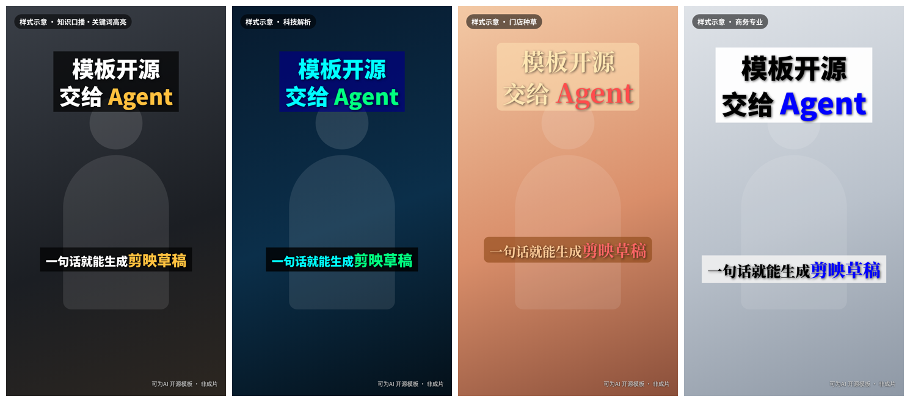

# 可为AI 剪映字幕模板（开源）

> 模板开源，拿去就能用。在 WorkBuddy、Claude Code、Codex 等 Agent 里粘贴一段提示词，就能在你自己电脑上生成**可以在剪映里继续编辑的草稿**。


<sub>图为样式示意，不是成片。</sub>

## 一段提示词用起来
见 [PROMPT.md](PROMPT.md)，复制到 Agent 里，把口播稿或 SRT 路径填进去即可。Agent 会：
检查/安装 `kewei-jianying` → 安装技能 → `doctor` 自检 → 选模板 → `build` 生成草稿。全程在本机运行，不上传文件。

## 手动安装与使用
```bash
uv tool install "git+https://github.com/ffzhen/kewei-jianying-templates"   # 或 pipx / pip install --user
kewei-jianying doctor                      # 检查 Python、依赖、剪映草稿目录
kewei-jianying where                       # 自动找到的剪映草稿目录 + 来源 + 全部候选
kewei-jianying list                        # 4 套字幕模板 + 30 种字幕动效
kewei-jianying build -t zhishi-koubo --srt examples/sample.srt -k examples/keywords.json \
  --title "把字幕模板交给Agent" -n demo     # 生成到剪映草稿目录
kewei-jianying install-skill               # 把 SKILL.md 装进 ~/.workbuddy/skills（--agent claude|codex|codebuddy）
```
常用参数：`--text-file 口播稿.txt`（没有字幕时按标点切句估算时长）、`--motion upper_lower|typing|none…`、`--video 口播.mp4`、`--audio 配音.wav`、`--bgm 音乐.mp3`、`--draft-root <剪映草稿目录>`、`--json`（给 Agent 解析）。
草稿目录自动探测（`kewei-jianying where` 查看结果与依据）：`--draft-root`/环境变量 `KEWEI_JIANYING_DRAFT_ROOT` → 剪映/CapCut 设置里的「草稿位置」（`User Data/Config/globalSetting` 的 `currentCustomDraftPath`，Mac 沙盒 plist）→ 默认目录（Mac `~/Movies/JianyingPro/User Data/Projects/com.lveditor.draft`，Windows `%LOCALAPPDATA%\JianyingPro\User Data\Projects\com.lveditor.draft`，以及 CapCut 对应目录）→ 扫描 `D:`/`E:` 等盘的 `JianyingPro Drafts`，取最近有草稿的。草稿先在临时目录生成再放进去，同名不覆盖（`--replace` 会把旧草稿备份到 `.kewei-replaced/`）；草稿目录有 `root_meta_info.json` 且剪映没在运行时，会备份后把新草稿登记进首页列表（`--no-register` 关闭，`kewei-jianying register <名字>` 补登记）。依据与待确认项见 [docs/draft-location.md](docs/draft-location.md)。

## 四套模板
| id | 模板 | 适合 | 默认动效 |
|---|---|---|---|
| zhishi-koubo | 知识口播·关键词高亮 | 知识博主、专家 IP | 上下式（关键词弹入下方） |
| keji-jiexi | 科技解析 | AI、数码、科技解读 | 打字机 |
| mendian-zhongcao | 门店种草 | 门店、餐饮、生活方式 | 可爱弹出 |
| shangwu-zhuanye | 商务专业 | 律师、财税、B2B | 渐显 |

字幕动效来自可为AI 生产系统的字幕包装预设（多片段联动：上下式、左右式、三行式、排比、列举……），开源版去掉了音效和关键帧联动。

## 目录
```
src/kewei_jianying/          CLI（cli / builder / subtitles / paths / draft_utils）
src/kewei_jianying/templates 模板参数与 9:16 预览
src/kewei_jianying/motions.json 30 种字幕动效预设
skills/kewei-jianying/       Agent Skill（与包内 skill/ 相同）
examples/                    示例字幕、关键词、生成好的草稿
tests/                       草稿校验与端到端脚本
```

## 说明与边界
- 草稿通过开源项目 [pyJianYingDraft](https://github.com/GuanYixuan/pyJianYingDraft) 0.3 生成，是非官方格式，剪映大版本更新后可能需要升级。同时写出 `draft_content.json`（Windows）和 `draft_info.json`（Mac）。
- 不包含字体文件；模板只引用剪映内置字体名，首次打开剪映可能需要联网下载字体/动画。
- 「剪映」是其权利人的商标，本项目与其没有关联。

## 需要更多？找可为AI
批量出片、选题脚本、数字人口播、导出剪映草稿接着改、团队专属模板定制，都可以找我们。


微信扫码，备注「模板」｜官网 https://keweiai.cn

## 许可
- `src/` 与 `tests/` 中的代码：Apache License 2.0（见 `LICENSE-APACHE-2.0`、`NOTICE`）
- 模板 JSON、动效预设、预览图和文档：CC BY 4.0（见 `LICENSE-CC-BY-4.0`），转载或改编请注明「可为AI」并附上本仓库链接
